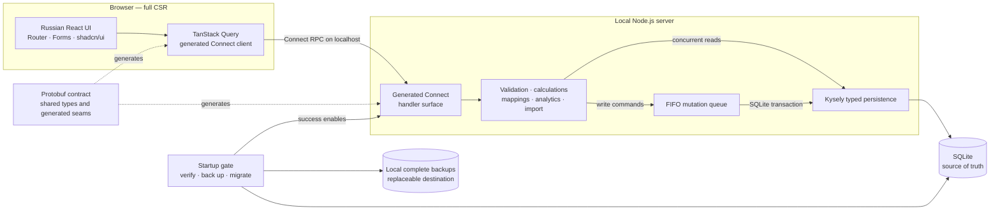

# Sales Tracking — MVP

Status: ready-for-agent

## Problem Statement

The creator places ceramic products at multiple outlets. Each outlet periodically reports what sold, what remains in stock, and how much accrued to the creator. Once several outlets are involved, separate report files and outlet-specific listing names make it difficult to answer basic questions reliably:

- How much has the creator earned?
- How much did the outlets retain?
- Which products sell best or produce the highest earnings?
- What stock currently remains at each outlet?
- Which differently named outlet listings represent the same product?

The application must turn these reports into one durable, locally operated source of truth. It must preserve the outlet's original listing names while allowing the creator to group equivalent listings into canonical Products. It must support both manual Sales reports and the fixed-format Report file already used by the creator.

The data is personally and commercially important. Confirmed changes must survive restarts and application updates, concurrent requests must not corrupt the data, and recoverable backups must exist before migrations or later runs can endanger the primary data.

## Solution

Build a Russian-language, desktop-oriented local web application for a single creator. A local Node.js server owns validation, calculations, persistence, analytics, backups, and migrations. A browser client provides the editing and review experience.

The creator maintains a Product catalog and a list of Outlets. Each Outlet may have an Outlet code used to associate its portion of a Report file. A Sales report belongs permanently to one Outlet, covers one Reporting period, records aggregated sales, and provides the complete Stock balance at the period end.

Outlet listings retain the exact names supplied by each Outlet. Persistent Product mappings associate those Outlet listings with canonical Products. Unmapped listings remain valid and visible in analytics until the creator maps them.

The MVP provides:

- Product and Outlet maintenance;
- manual Sales report entry and correction;
- fixed-format Excel Report file import into an editable, all-or-nothing form;
- persistent and historically effective Product mappings;
- Sales report history, historical Stock balances, current Stock balances, totals, comparisons, and rankings;
- local durable storage, startup backups, and migrations.

### Architecture summary

## User Stories

### Getting started and maintaining Products

1. As the creator, I can open a new installation with no existing data and begin by creating Products and Outlets.
2. As the creator, I can create a Product with a non-empty canonical name.
3. As the creator, I am prevented from creating or renaming a Product to an exact name already used by another Product.
4. As the creator, I can use names that differ only by case, whitespace, punctuation, or spelling because Product name equality uses the exact entered string and performs no normalization.
5. As the creator, I can rename a Product and see its current name in all current and historical application views without changing the original Outlet listing names.
6. As the creator, I can archive a Product without destroying its history.
7. As the creator, I can restore an archived Product.
8. As the creator, I normally see only active Products in new selections while archived Products remain visible in historical data.

### Maintaining Outlets

9. As the creator, I can create an Outlet with a non-empty, unique name.
10. As the creator, I am prevented from creating or renaming an Outlet to an exact name already used by another Outlet.
11. As the creator, I can create and fully use an Outlet without assigning an Outlet code.
12. As the creator, I can optionally assign an Outlet code, and every non-empty Outlet code must be exactly unique among Outlets.
13. As the creator, I can add, change, or remove an Outlet code at any time, provided the resulting non-empty code remains unique.
14. As the creator, I understand that changing an Outlet code does not detach historical Sales reports from the Outlet, while a future Report file using the old code no longer identifies it.
15. As the creator, I can rename an Outlet and see the current name throughout the application because Sales reports refer to the Outlet's immutable identity rather than copying its name.
16. As the creator, I can archive an Outlet without destroying its Sales reports, listings, mappings, or analytics history.
17. As the creator, I can restore an archived Outlet.
18. As the creator, I normally see only active Outlets in new selections while archived Outlets remain available in historical views.
19. As the creator, I can use an Outlet without a code for manual Sales reports and analytics, but that Outlet cannot receive imported data until a code is assigned.

### Creating and correcting Sales reports

20. As the creator, I can manually create a Sales report for one selected Outlet and one Reporting period.
21. As the creator, I must enter a Reporting period start and end date, and the end date cannot precede the start date.
22. As the creator, I can create reports with overlapping or repeated Reporting periods; the application does not reject them merely because another report covers the same dates.
23. As the creator, I enter the period's sales as one aggregated row per Outlet listing, containing the exact listing name, Units sold, and total Earnings.
24. As the creator, I enter the period-end inventory as one row per Outlet listing, containing the exact listing name, Stock balance, and Outlet price.
25. As the creator, I cannot repeat the same exact Outlet listing name within the sales section of one Sales report.
26. As the creator, I cannot repeat the same exact Outlet listing name within the Stock balance section of one Sales report.
27. As the creator, I can use the same Outlet listing once in each section, and both occurrences share one Outlet price for that Sales report.
28. As the creator, when a listing appears in sales but not in the Stock balance section, I must supply its Outlet price with the sales entry.
29. As the creator, I can enter only whole, non-negative Units sold and Stock balances.
30. As the creator, I can enter only non-negative monetary amounts in whole kopecks.
31. As the creator, I cannot record Earnings greater than `Units sold × Outlet price`.
32. As the creator, I see Outlet share calculated for every sales entry as `Units sold × Outlet price − Earnings`.
33. As the creator, I may omit a listing from the sales section when nothing sold; that means zero Units sold, zero Earnings, and zero Outlet share for that report.
34. As the creator, I understand that the Stock balance section is the complete inventory at the period end. A previously known listing omitted from that section has a Stock balance of zero.
35. As the creator, I can save a Sales report with no sales rows and no Stock balance rows; this records zero sales and an empty Outlet inventory rather than a neutral or no-op report.
36. As the creator, I can edit any active Sales report, including its Reporting period, listings, quantities, prices, and Earnings.
37. As the creator, I cannot change a saved Sales report's Outlet. Correcting the Outlet requires archiving that report and creating the correct report for the other Outlet.
38. As the creator, after correcting a Sales report I see all Stock balances, Earnings, Outlet shares, mappings, and analytics recalculated from the corrected data.
39. As the creator, I can archive a Sales report instead of physically deleting it.
40. As the creator, I can view archived Sales reports through an Archived filter and restore one when needed.
41. As the creator, an archived Sales report is read-only until restored and is excluded from current Stock balances and ordinary analytics by default.
42. As the creator, no Product, Outlet, or Sales report is physically deleted through the application.

### Importing a Report file

43. As the creator, I can import the one fixed Excel workbook structure supported by the MVP.
44. As the creator, I can import one Report file containing a single Reporting period and data for multiple Outlets.
45. As the creator, I receive a clear rejection when the workbook structure or a value cannot be parsed, including the relevant cell or location and the expected kind of value.
46. As the creator, I see one parsing or validation problem at a time so that I can correct the source file and retry.
47. As the creator, no editable report form opens and no data is recorded when any part of the Report file fails structural validation.
48. As the creator, I am protected from a file that repeats an Outlet report: each Outlet code may identify at most one Outlet section in the file.
49. As the creator, I am protected from a file that repeats the same exact listing within an Outlet's sales section or within its Stock balance section.
50. As the creator, a Report file is rejected if it contains an unknown Outlet code. I can create the Outlet or correct its Outlet code separately and then retry the import.
51. As the creator, an archived Outlet found by its code is dropped from the import by default, and I can restore that Outlet to include its report.
52. As the creator, I cannot drop an individual active Outlet from an otherwise valid import.
53. As the creator, after a file passes validation I see one fully editable form grouped by Outlet, using the same fields and validation rules as manual Sales report creation.
54. As the creator, I can correct parsed dates, listings, quantities, prices, Earnings, and Product mappings before saving.
55. As the creator, I can either save every included Outlet's Sales report together or cancel the entire import; a partial save cannot occur.
56. As the creator, after a successful import each resulting outlet-local Sales report becomes an independent report that can later be viewed, corrected, or archived.
57. As the creator, importing data for an Outlet and Reporting period that already has another Sales report is allowed; the application does not infer that the reports are duplicates.

### Mapping Outlet listings to Products

58. As the creator, I can leave a newly encountered Outlet listing Unmapped and still save its Sales report.
59. As the creator, I can map an Outlet listing to an existing Product.
60. As the creator, I can create a new Product directly while mapping an Outlet listing.
61. As the creator, a Product mapping is identified by the Outlet and the listing's exact name, so the same listing in later Sales reports automatically reuses the mapping even when its Outlet price changes.
62. As the creator, I can remap an Outlet listing to a different Product.
63. As the creator, I can remove a Product mapping and return that Outlet listing's history to an Unmapped listing group.
64. As the creator, mapping, remapping, or removing a mapping immediately reclassifies all historical and current results for that Outlet listing.
65. As the creator, an existing mapping to a Product remains effective if that Product is later archived.
66. As the creator, I can view Outlet listings with All, Unmapped, and Mapped filters; entering from the mapping workflow defaults the view to Unmapped.
67. As the creator, I see Unmapped listings visibly distinguished from Products in analytics rather than omitted from totals.
68. As the creator, Unmapped listings from all Outlets are grouped by exact listing-name equality, without normalizing case, whitespace, punctuation, or spelling.
69. As the creator, an Unmapped listing is not implicitly treated as an existing Product even when its exact name equals that Product's name; I must map it explicitly.
70. As the creator, when an exact-name Unmapped group comes from several Outlets, I map each Outlet listing explicitly; mapping one does not silently map the others.
71. As the creator, the MVP does not offer fuzzy, spelling-based, or remembered Product suggestions.

### Reviewing history, stock, and analytics

72. As the creator, I can open an Outlet's Sales report history and filter it by archive state.
73. As the creator, I can open any historical Sales report and inspect the Stock balances recorded by that report.
74. As the creator, current Stock for an Outlet listing comes from the active Sales report with the latest Reporting period end date.
75. As the creator, when two active reports for the same Outlet listing have the same Reporting period end date, the report saved most recently determines current Stock. Saving an edit updates that ordering.
76. As the creator, editing or archiving a report immediately recalculates which report determines current Stock.
77. As the creator, I can select one, several, or all complete Sales reports as the input for sales analytics.
78. As the creator, I can independently select one, several, or all Outlets for analytics.
79. As the creator, I can combine Sales reports with different Reporting periods and see the selected periods clearly identified.
80. As the creator, analytics sum Units sold, Earnings, and Outlet share across the selected reports and selected Outlets.
81. As the creator, current Stock in analytics uses the latest active Sales report for each Outlet listing in the selected Outlets, rather than summing historical Stock balances or slicing a report by date.
82. As the creator, I can see overall totals for current Stock balance, Units sold, Earnings, and Outlet share above detailed comparison results.
83. As the creator, I can compare and sort Products by current Stock balance, Units sold, Earnings, or Outlet share.
84. As the creator, I can use Product ranking presets for Most sold, Highest earnings, and Lowest stock.
85. As the creator, Product comparisons group every mapped Outlet listing under its Product and include marked Unmapped listing groups alongside Products.
86. As the creator, I can open a Product and see every mapped Outlet listing contributing to it, with results broken down by Outlet.
87. As the creator, I can compare and sort Outlets by current Stock balance, Units sold, Earnings, or Outlet share.
88. As the creator, I can open an Outlet and see its current Stock balances, Product results, Unmapped listings, and Sales report history.

### Local use, safety, and usability

89. As the creator, I can start the application with one terminal command; it waits for the local server to become ready and then opens in my default supported browser.
90. As the creator, I can use every MVP feature without an internet connection.
91. As the creator, every save confirmed by the application survives normal shutdown, restart, and application updates.
92. As the creator, a crash during a change leaves either the complete committed change or no change; I retry a change whose success was not confirmed.
93. As the creator, I receive a usable Russian interface with keyboard-operable forms, labelled controls, readable contrast, visible validation messages, and browser zoom support.
94. As the creator, my application data, diagnostics, and usage information are never sent to external services.

## Implementation Decisions

### Runtime and deployment

- The application is a desktop-oriented local web application with a full client-side-rendered interface. It does not provide SSR.
- The server runtime is Node.js. Client, server, and shared code are TypeScript.
- The codebase has three general runtime boundaries: server runtime, client runtime, and environment-neutral shared definitions.
- The server binds only to the local computer and does not accept LAN or internet connections.
- There is no authentication because the application is local and single-creator.
- The built application has no runtime dependency on the internet or an external service and emits no telemetry.
- One command starts the server, waits for readiness, and opens the application in the default supported browser.
- The implementation must not depend on a specific operating system or use OS-sensitive APIs without an abstraction.
- The supported browser target is evergreen Chromium. Do not ship polyfills or compatibility workarounds for legacy browsers, Firefox, or WebKit.
- Updates are manual: rebuild/recompile the application and run its migrations. There is no automatic updater.

### Client application

- Use React, Vite, shadcn/ui with minimal customization, typed file-based TanStack Router, TanStack Form, and TanStack Query.
- The client is a thin view layer. The server remains authoritative for domain validation, calculations, persistence, and analytics.
- Use a network-first query strategy. The query cache is not a persistent source of truth, mutations are not optimistic, and successful mutations invalidate affected queries.
- Configure TanStack Query to issue localhost requests even when the browser reports that the computer is offline.
- Provide the network transport once at the application root so tests can replace it without including a service-worker mocking dependency in the production application.

### Network contract and shared types

- Use Connect, Protobuf-ES, and Connect-Query with RPC-shaped endpoints.
- Maintain one Protobuf network contract from which models, service descriptors, typed Node.js handler surfaces, browser clients, and Connect Query integrations are generated.
- Use Protobuf `oneof` declarations for algebraic alternatives in the network contract.
- The Protobuf contract is a network representation. Internal domain entities and database rows remain separate representations.
- Use branded TypeScript identifiers in shared and server code where additional identity safety is valuable. Convert explicitly at Protobuf and database boundaries rather than wrapping every identifier in a Protobuf message.
- Generated source is never edited manually.
- MVP RPCs are unary and use Connect's JSON wire format.

### Persistence, calculations, and concurrency

- Use one same-process SQLite relational database as the authoritative store; do not introduce a separate analytics database or OLAP system.
- Access SQLite through Kysely with database types generated by kysely-codegen, backed by better-sqlite3. Verify generated database types during the build.
- Pin mutually compatible versions of Kysely, kysely-codegen, better-sqlite3, and their type declarations during implementation.
- Store all monetary values as whole integer kopecks. Validate JavaScript safe integers at runtime and use SQLite's signed 64-bit integer storage. Do not use floating-point monetary arithmetic.
- Serialize every write-inducing operation through one process-wide FIFO mutex. Execute its complete read-modify-write sequence within both the mutex and one SQLite transaction.
- Allow read-only operations to execute concurrently with one another. The database transaction remains the final consistency boundary.
- The MVP accepts last-write-wins behavior for concurrent edits; it does not add revision conflicts or client-side merge UI.
- Return mutation success only after the durable database transaction commits. An interrupted transaction commits completely or rolls back completely.
- Do not automatically replay an interrupted business operation. The creator retries when no successful result was confirmed.
- The expected scale is fewer than 50 Outlets, about one report per Outlet per month, and about ten listings per report. Compute analytics from SQLite data without specialized precomputation unless measurements show a need.

### Sales report, import, mapping, and analytics rules

- A Sales report belongs to one immutable Outlet identity. Outlet names are not copied into Sales reports.
- Outlet listing continuity and Product mapping use the exact pair of Outlet identity and listing name. Outlet price is report-specific and may be corrected when a report is edited.
- Treat the Stock balance section as the complete end-of-period inventory. Missing listings have zero Stock balance.
- Derive Outlet share from `Units sold × Outlet price − Earnings`; it is not a separate user-entered amount.
- The fixed-format Excel parser validates the complete file before opening the form. It reports one actionable problem at a time and never records a partially parsed file.
- A valid multi-Outlet import uses the ordinary Sales report form grouped by Outlet and commits all included reports in one atomic operation.
- Report-file Outlet association is an exact Outlet code lookup, not a user-maintained source mapping. Unknown codes require correction outside the import flow.
- Product mappings apply retroactively by resolving analytics through the current mapping rather than copying a Product identity into every historical row.
- Preserve exact raw Outlet listing names. Unmapped analytics grouping uses simple exact string equality across Outlets.
- Sales analytics aggregate complete selected Sales reports. Current Stock is a latest-state measure and is never summed across historical reports.

### Durability, backup, migration, and recovery

- Use a replaceable asynchronous backup-destination interface. The MVP implements a local-filesystem destination; later destinations may copy backups elsewhere.
- The startup sequence completes backup and migration work before the server listens or opens the browser. Await asynchronous backup operations and protect publication/rotation with locks.
- Verify the primary database before creating or rotating backups. Refuse normal startup and preserve all existing backups if verification fails.
- When the primary data has changed since the latest routine backup, create at most one routine backup during that application start.
- Each backup is a complete recoverable database copy, not an incremental fragment.
- Publish a new backup durably and atomically, verify the published copy, and only then rotate older backups. Never remove an older usable backup while its replacement is incomplete or unverified.
- Retain the latest five routine backups.
- Before any migration, first synchronize the routine backup described above, then create and verify a distinct pre-migration backup, and only then apply migrations.
- Retain the latest five pre-migration backups independently from routine backups.
- If backup verification or migration fails, leave the application unavailable for ordinary use, preserve the primary data and existing backups, and show recovery guidance.
- A restored older database runs all pending migrations before it is used.
- Document the backup location, restore procedure, migration recovery procedure, and the limitation that a same-device local backup does not protect against device loss.

### Quality attributes

- Ordinary views, edits, and analytics must complete within two seconds against a seeded ten-year expected dataset on the target computer.
- Parsing the maximum expected Report file of roughly 50 Outlets with ten listings each and opening its editable form must complete within five seconds.
- A production build must meet the official Core Web Vitals “good” thresholds under the seeded local workload: LCP at most 2.5 seconds, INP at most 200 milliseconds, and CLS at most 0.1.
- The Russian UI must be keyboard-operable, use labelled controls, provide readable contrast and visible validation, and remain usable with browser zoom. No formal accessibility certification is required.

## Testing Decisions

### Test seams and projects

- Vitest is the sole test runner and defines separate server-runtime and browser-runtime projects.
- Tests assert externally observable user or domain behavior through the highest practical seam. They do not assert internal call order or private implementation details unless that behavior is itself the contract.
- The primary server seam is the generated Connect handler surface backed by a real isolated SQLite database. Server tests are mostly integration tests through handlers.
- The primary client seam is the complete prebuilt client application with an injected generated Connect transport. Browser tests are mostly integration and screenshot tests.
- The full-system seam is the prebuilt client application connected to a real Node.js server and isolated SQLite database, still orchestrated by Vitest. Ticket 12 introduces this seam for the critical MVP workflow; earlier client browser tests use the injected generated transport.
- Do not create a separate transport test suite. Generated transport code is exercised by compilation and the client/server integration seams.

### Server tests

- Give every server integration test file an isolated temporary SQLite database and backup directory. Never mock Kysely or better-sqlite3.
- Test complete domain operations through Connect handlers, including validation failures and recalculated results.
- Use focused unit tests only for pure functions or edge-case matrices that would make handler integration tests prohibitively slow.
- Test Report-file parsing with committed, small synthetic `.xlsx` fixtures. Cover the valid fixed format and individual failures including invalid cell types, duplicate Outlet codes, duplicate listings, unknown Outlets, and malformed Reporting periods.
- Test backup and migration behavior in isolated temporary directories, including rotation, preservation after failed backup, integrity rejection, pre-migration ordering, successful restore, and migration of restored older data.
- Centralize nondeterministic environment behavior such as clocks and identity generation in an EnvService. Tests may patch that service with Vitest spies and must restore it after each test; tests that patch the same global service do not run concurrently.

### Client tests

#### Application prebuilding, serving, and mounting

- Use the Vitest browser provider with evergreen Chromium only. Do not maintain a separate Playwright test-runner suite.
- Build one test-mode application bundle during Vitest global setup before browser tests run.
- Emit one ESM JavaScript bundle and one CSS bundle. Disable code splitting, minification, source maps, public-directory copying, and compressed-size reporting for this test build.
- Serve the bundle from an explicit test-only URL through Vitest/Vite static middleware.
- Derive the Vitest tester page from the normal application HTML: remove the development entry and unrelated injected assets, then inject the prebuilt JavaScript and CSS.
- Expose a test API from the bundle containing `mount`, `unmount`, the application QueryClient, and the application-root transport override.
- Open a route with `history.replaceState()` and then call `mount()`. Client-side routing must not replace or destroy the Vitest runner document.
- `mount()` first unmounts any existing React root, and every test unmounts the application during cleanup, so two complete applications never share one tester page.
- Build once in headless runs. Interactive runs may watch and rebuild, but must wait for the initial bundle before starting tests.
- Prebundle browser-runner dependencies required by the tester page to avoid mid-run Vite re-optimization and dynamic-import failures.
- Initialize the mounted application in its production Russian language.

#### Test isolation and deterministic rendering

- Reuse one persistent Chromium context for speed, but restore complete application-level isolation before every test.
- Set both the browser viewport and the Vitest iframe viewport to the same fixed dimensions.
- Reset every Vitest mock and mock implementation and create fresh generated RPC service spies before each test. Generated model stubs use fixed deterministic defaults and carry no resettable identity or random state.
- Install fake timers at one fixed instant and enable automatic timer advancement required by TanStack Query scheduling.
- Clear local storage, session storage, and the TanStack Query cache before each test.
- Fix locale and timezone for the complete browser project.
- Prevent tester and test-dependency styles from leaking into the application while retaining the prebuilt application's own CSS.
- Stabilize screenshots by disabling animations, transitions, smooth scrolling, and carets; move the pointer away and wait for loaders, skeletons, and spinners to disappear before capture. Any future transient notification facility must define deterministic screenshot treatment when introduced.
- Store screenshots at deterministic locations colocated with the corresponding test hierarchy.

#### Generated model stubs and RPC mocks

- Generate typed model stubs and service mocks from the Protobuf contract with a project-owned Buf plugin named `protoc-gen-test`.
- Generate `create<Model>Stub(overrides)` for every contract model. It returns fixed deterministic populated defaults, builds nested messages, selects deterministic `oneof` variants, and accepts typed partial overrides.
- Generate one typed mock-service property for every unary RPC, backed by a Vitest `vi.fn` spy.
- Give each RPC spy compact typed helpers equivalent to `resolves(value)`, `rejects(error)`, and `getLastRequest()`. The request helper waits for and returns the latest typed request.
- Give known RPCs generated response-stub defaults so a test configures only behavior relevant to its scenario.
- Create fresh service spies and an injected Connect transport for every test. A request outside the installed generated service surface fails instead of reaching a real network.
- Inject the mock Connect transport at the client application root. Do not add MSW solely for Connect mocking.
- Keep reusable scenario arrangements and domain-specific factory wrappers separate from generated code. Use a small companion configuration for exceptional defaults instead of adding test-only data to the production Protobuf contract.

#### Page objects

- Use small factory-function page objects rather than classes.
- Colocate each page object with one feature or route; promote it to a shared feature test utility only when several test files use it.
- Expose user-meaningful operations and semantic locators, such as opening a route, submitting a form, locating a Product row, or capturing a named screenshot.
- Keep scenario expectations in the test. A page-object operation may contain only synchronization intrinsic to completing that operation.
- Prefer accessible role-and-name locators. Use stable test identifiers only for application-specific regions or controls that lack a suitable accessible locator.
- Encapsulate repeated interaction mechanics, including route opening, screenshot boundaries, drag-and-drop, and complex row lookup, without hiding the scenario itself.
- Extend one common browser page API when iframe coordination or nonstandard controls require a workaround rather than duplicating that workaround across tests.

### Scenario allocation

- Keep the critical full-system browser workflow deliberately small. It covers creating Products and Outlets, importing and correcting a Report file, performing initial Product mapping, and viewing analytics and current Stock.
- Cover manual Sales report creation, historical remapping, and report archive/restore in the appropriate server or client integration projects rather than duplicating them in the critical full-system workflow.
- Use fixed Chromium screenshot tests for stable visual states and compare them with the client-approved design drafts.
- Regenerate Protobuf, Connect Query, generated test artifacts, and Kysely database types in CI; fail when generation produces an uncommitted difference.
- Publish coverage reports to expose untested modules, but do not set an arbitrary global coverage percentage. The agreed behavior and critical scenarios determine sufficiency.
- Verify the Core Web Vitals targets manually against a production build and seeded ten-year dataset in the MVP. A repeated percentile performance suite is deferred to the backlog.

## Out of Scope

- Product images.
- Package planning, production progress, package statuses, or delivery tracking.
- Forecasting or recommending future package contents.
- Search across Products, Outlets, Outlet listings, or Sales reports.
- Multiple creators, collaboration, accounts, roles, invitations, authentication, or shared workspaces.
- Mobile or tablet layouts.
- Firefox, WebKit, legacy browser support, polyfills, or compatibility hacks.
- LAN hosting, internet hosting, cloud synchronization, or remote access.
- A cloud backup destination in the MVP; only the extension interface and local destination are included.
- Multiple Report-file formats, free-form spreadsheet detection, partial imports, or importing individual Sale transactions.
- Creating unknown Outlets inside the import form or mapping source Outlet names to existing Outlets.
- Fuzzy Product matching, automatic name-based suggestions, or remembered mapping suggestions.
- Tracking production cost, profit, payment transfers, or whether accrued Earnings have been paid.
- Physical deletion, a general audit log, or general undo. Archiving and restoration provide the required reversible lifecycle.
- Automatic replay of interrupted commands, mutation idempotency identifiers, optimistic locking, stale-edit rejection, or conflict-resolution UI.
- A persistent client query cache or optimistic client mutations.
- A separate OLAP database or precomputed analytics pipeline.
- An automatic application updater.
- A dedicated Playwright test-runner suite or automated repeated Core Web Vitals percentile suite.

## Further Notes

- Documentation and programming terminology use the canonical English terms in `GLOSSARY.md`. The application interface uses the mapped Russian labels and is Russian-only in the MVP.
- The application name and visual system are defined in `docs/ui-design.md`; UI implementation and review treat it as the source of truth.
- All displayed prices and monetary results are rubles, while persisted and transported values use whole kopecks.
- The approved visual direction is represented by the local analytics, Product-mapping, and Report-flow showcase images under `artefacts/`. The non-`original` Report-flow image is the current version, and `docs/ui-design.md` resolves normalized identity and token decisions.
- The real example Report file is local and ignored by Git. Automated parser tests must use purpose-built committed fixtures that contain no private business data.
- The selected API and typed persistence stack is supported by the findings in `docs/research/typed-data-and-api-tooling.md`.
- The stack is accepted without a throwaway technical validation prototype. Implementation should retain the already resolved package choices and address ordinary version compatibility while assembling the production project.
